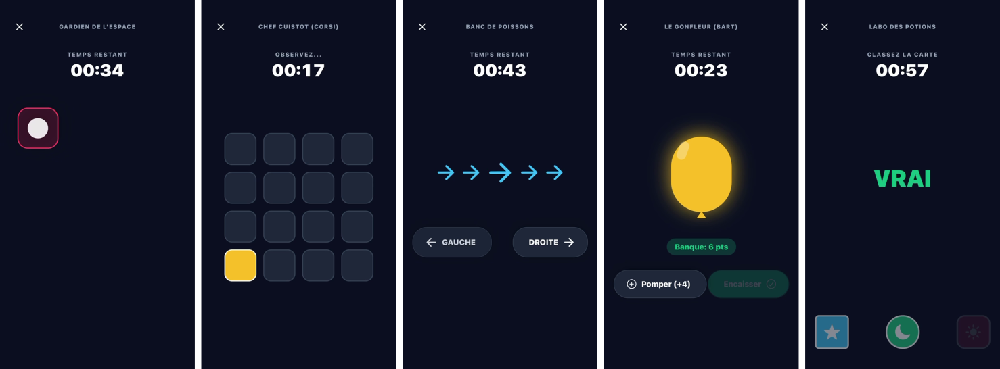
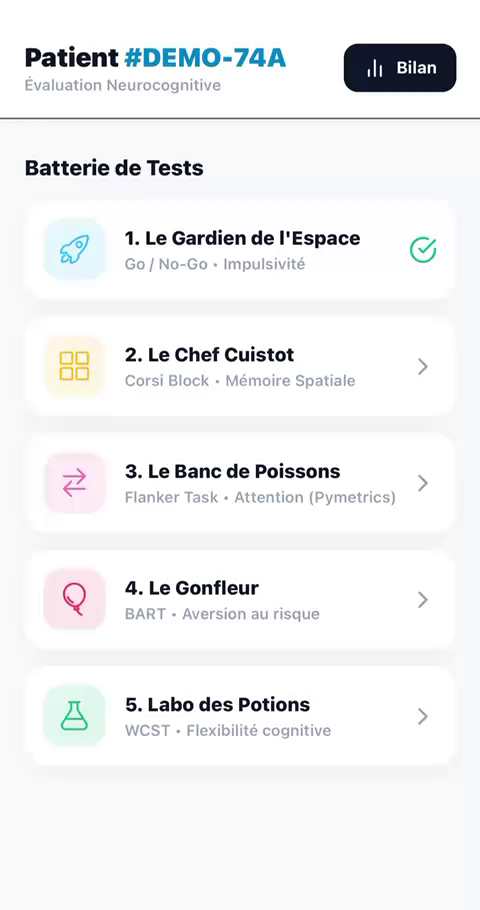
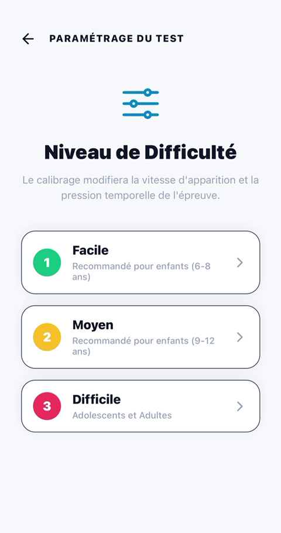
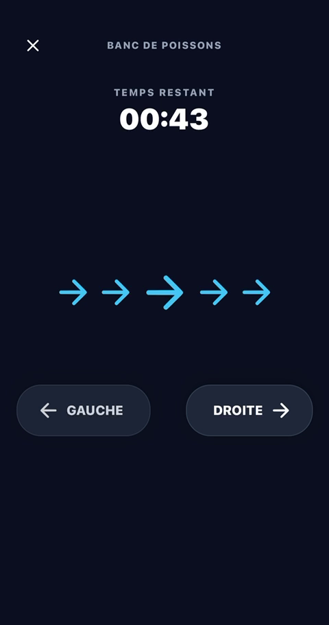

# DiagFocus

**Avec DiagFocus, retrouver le chemin vers un diagnostic éclairé du TDAH.**

DiagFocus turns five neuropsychology tests into short mobile mini-games, to help spot attention difficulties in children earlier, at school or at the family doctor, and give clinicians objective data to work with.

Created by the DiagFocus team at the **Hack'In Pharma 2026** hackathon.

## The problem

Many children with ADHD (TDAH in French) are never diagnosed. Instead of being helped, they get labelled as distracted, "tête en l'air", and told to concentrate.

Objective attention tests such as TOVA show that attention can be measured. But they are long and monotonous, only used in specialist assessments, not accessible to schools, not integrated into the care pathway, and offer no follow-up over time.

## The idea

Bring that kind of objective measurement **upstream** in the care pathway, directly into schools and primary care: a playful test battery a child takes on a phone or tablet, where each game is a child-friendly version of a test used in clinical neuropsychology.

DiagFocus is a **screening and orientation aid, not a diagnostic tool**. Computerised attention tests can inform a clinical assessment, but they can neither confirm nor rule out ADHD on their own. The diagnosis stays with the clinician.

## The test battery

| # | Game | Based on | What it measures |
|---|---|---|---|
| 1 | **Le Gardien de l'Espace** | Go/No-Go | Inhibition and impulsivity: tap the green orbs as fast as possible, ignore the red ones |
| 2 | **Le Chef Cuistot** | Corsi block-tapping | Spatial memory: watch tiles light up in a grid, then reproduce the sequence |
| 3 | **Le Banc de Poissons** | Eriksen flanker task | Selective attention: blue arrows mean answer with the centre fish's direction, red arrows mean the outer fish's direction |
| 4 | **Le Gonfleur** | Balloon Analogue Risk Task (BART) | Risk-taking: pump the balloon to earn points and cash in before it pops (the colours hide a secret) |
| 5 | **Le Labo des Potions** | Wisconsin Card Sorting Test (WCST) | Cognitive flexibility: sort the mystery card into the right bin, following a secret rule that can change without warning |

Three difficulty levels adjust how fast items appear and the time pressure: **Easy** (ages 6 to 8), **Medium** (ages 9 to 12), and **Hard** (teenagers and adults).

See [docs/science.md](docs/science.md) for the scientific background and references for each test.

  
  
  

## Planned care pathway

1. **Screening** in schools and primary care with the game battery.
2. **Questionnaire**: a digital version of the Conners rating scale.
3. **Report**: an automatically generated summary for the doctor.
4. **Follow-up**: repeated sessions to track progress over time.

## Field research

The concept was shaped by **30+ meetings** with professionals and volunteers, including child psychiatrists, pharmacists, pharmaceutical market-access professionals, a school principal and a school nurse, web developers, AI and computer science students, and a strategy student, as well as **35+ patients**.

## Roadmap

- [x] Mobile prototype of the five games and difficulty levels
- [ ] Digital Conners questionnaire
- [ ] Automated report for the doctor
- [ ] Health-data hosting with French HDS certification
- [ ] Clinical study
- [ ] CE marking as a medical device

## Team

Built by the DiagFocus team at Hack'In Pharma 2026, including:

- **Gaïa Mezaïb Boti** ([@gaiaflaviamezaib](https://github.com/gaiaflaviamezaib)), engineering student at CentraleSupélec and McGill University
